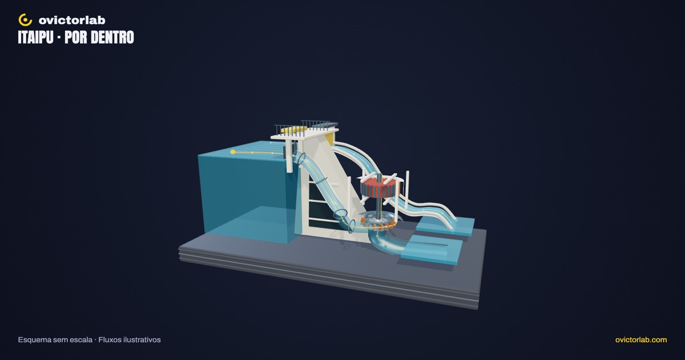
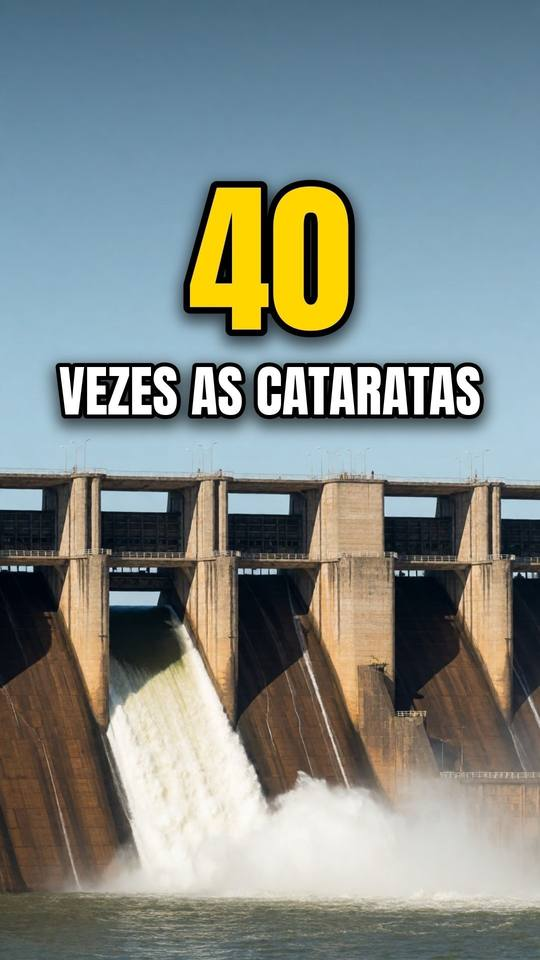

# Itaipu por dentro

**[Abrir a experiência →](https://victorsodre.github.io/itaipu-por-dentro/)** · [Os 10 experimentos](docs/COLECAO.md) · [Publicação e manutenção](docs/PUBLICACAO.md)

[](https://victorsodre.github.io/itaipu-por-dentro/)

**Por onde a água passa para gerar energia?**

Um corte educativo localizado, com caminho da água, uma unidade geradora simplificada e um caminho separado para o vertedouro. Nomear como esquema quando não houver geometria as-built.

Direção e autoria editorial: **Victor Sodré / ovictorlab**. [Site](https://ovictorlab.com/) · [Referência Fusquinha](https://victorsodre.github.io/fusquinha/) · [Repositório](https://github.com/victorsodre/itaipu-por-dentro).

## Entenda no vídeo

<a href="https://www.youtube.com/watch?v=C5yMvA3G82w"></a>

**[Quanta água o vertedouro de Itaipu aguenta? (a cheia nem chegou perto)](https://www.youtube.com/watch?v=C5yMvA3G82w)**

O vídeo mostra o vertedouro de Itaipu. No experimento, compare esse trajeto com o caminho da água pela unidade geradora.

O player incorporado fica [na página do experimento](https://victorsodre.github.io/itaipu-por-dentro/#video), com carregamento por clique e sem reprodução automática.

## Por que desenvolver

O Reel sobre o vertedouro registrou 4.397 visualizações; o Short correspondente tinha 1.131 no YouTube. O projeto amplia o tema para distinguir vertedouro e geração. Consulta em 07/11/2026. Métricas acumuladas são sinais de interesse; não comprovam demanda pelo aplicativo ou alcance orgânico.

- [Itaipu — Instagram](https://www.instagram.com/reel/DezrzmZHauw/)
- [Itaipu — YouTube](https://www.youtube.com/watch?v=C5yMvA3G82w)

## Começar por aqui

1. [Escopo e critérios de conclusão](docs/ESCOPO.md).
2. [Lista de execução](docs/EXECUCAO.md).
3. [Identidade visual do ovictorlab](docs/IDENTIDADE-VISUAL.md).
4. [Arquitetura implementada e reaproveitamento do Fusquinha](docs/ARQUITETURA.md).
5. [Assets e fontes verificadas](docs/ASSETS-E-FONTES.md).
6. [Manutenção, validação e publicação](docs/MANUTENCAO.md).
7. [Decisões e estado do projeto](docs/DECISOES.md).
8. [Textos para o X](POSTAGENS-X.md) e [ordem da coleção](docs/COLECAO.md).

## Executar e conferir

Node ≥22.18. Versões fixadas em `package-lock.json`.

```sh
npm ci
npm run dev
npm test
npm run check
npm run build
npm run preview
```

O build está em `dist/`, com caminhos relativos para funcionar em subpasta. Não exige backend, LLM, API paga nem a GPU de produção. [Validação e limites](docs/VALIDACAO.md) · [Apuração](docs/APURACAO.md) · [Direção visual](docs/DIRECAO-VISUAL.md).

## O que funciona

- Seguir a água por geração ou vertedouro, comparar os caminhos e controlar suas vazões de forma independente.
- Vertedouro em m³/s, de 0 à capacidade de 62.200 m³/s, com marcas datadas e com fonte (média das Cataratas, 13/10 e 15/10/2026). A comporta de segmento abre conforme a vazão, a lâmina engrossa e o trampolim lança o jato; com a comporta fechada, nenhuma água passa.
- Abrir a unidade e observar turbina, eixo e rotor girando juntos, com estator fixo. A água não passa pelo gerador.
- Explorar sete conjuntos (incluindo comporta e calha do vertedouro) por lista/toque, busca, isolamento, zoom, tour e retorno à vista completa.
- Percurso por slider/etapas, pausa, reset, malha e PNG horizontal 1920×1080 ou vertical 1080×1920.
- Interface responsiva, teclado, movimento reduzido, pausa em aba oculta e explicações acessíveis sem WebGL. Sem áudio ou autoplay.

**Limites:** diorama educativo sem escala, com uma unidade e uma comporta com calha que representam o vertedouro. Os caminhos estão aproximados para comparação; não representam a implantação real da usina. A abertura da comporta é proporcional à vazão de forma ilustrativa; a vazão da geração é qualitativa, sem RPM proporcional, potência calculada ou simulação hidráulica. Validação móvel emulada no Chrome; não ensaiado em telefone físico ou Safari.

Aplicação publicada no GitHub Pages, com vídeo incorporado e links conferidos. Os rascunhos do X permanecem para publicação manual posterior.
